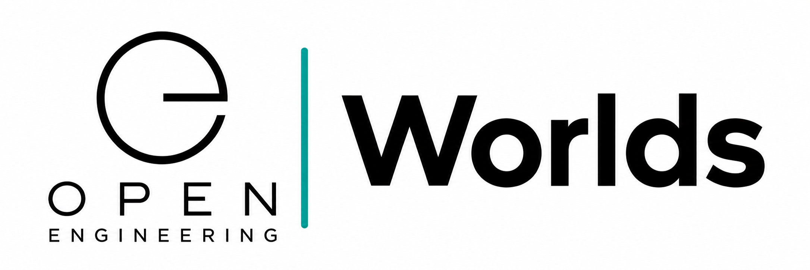

# Open Engineering Worlds

> **Don't build worlds from scratch. Assemble them.**



**Open Engineering Worlds** is the part of the Open Engineering ecosystem dedicated to defining, composing, and exploring interactive three-dimensional worlds.

It transforms software architectures, engineering concepts, business simulations, stories, and missions into environments that people can explore, understand, and interact with.

Rather than developing each virtual environment as an isolated application, Open Engineering Worlds uses reusable **bricks**, **capsules**, and **assemblies** to deliver coherent, interactive worlds.

A world is more than a 3D scene.

It is an assembled environment in which visual representations, domain knowledge, navigation, interactions, narration, and behavior work together.

---

## 🌍 Our Vision

**Make engineering worlds explorable, understandable, and reusable.**

Traditional software engineering relies heavily on diagrams, documents, models, and source code.

These representations are essential, but they do not always make complex relationships easy to understand.

Open Engineering Worlds introduces another dimension.

Imagine being able to:

- Walk through a software architecture.
- Enter a system as though it were a building.
- Explore relationships as pathways between locations.
- Inspect architectural decisions as physical artifacts.
- Assemble software capabilities at a virtual workstation.
- Navigate business processes as an interactive game.
- Follow a narrator through an engineering ecosystem.
- Complete missions that demonstrate how systems behave.

These experiences are not independent applications built from scratch.

They are **worlds assembled from reusable Open Engineering capabilities**.

---

## 🧱 From Bricks to Worlds

Open Engineering follows an assembly-oriented approach inspired by the composability of systems such as LEGO.

The same philosophy applies to virtual worlds.

```text
                 SOFTWARE PRODUCT
                        │
                        ▼
                  WORLD ASSEMBLY
                        │
           ┌────────────┼────────────┐
           │            │            │
           ▼            ▼            ▼
        SCENES      CAPSULES      STORIES
           │            │            │
           └────────────┼────────────┘
                        │
                        ▼
                      BRICKS
                        │
                        ▼
                 REUSABLE ASSETS
```

### Bricks

Bricks are reusable elements from which larger capabilities can be composed.

Examples include:

- Model references.
- Scene placements.
- Material definitions.
- Camera definitions.
- Lighting configurations.
- Animation definitions.
- Navigation points.
- Interaction bindings.
- Semantic references.

A visual model may represent a brick, but the model itself is not necessarily the underlying domain brick.

### Capsules

Capsules provide bounded, reusable capabilities.

Examples include:

| Capsule | Responsibility |
|---|---|
| Visualization | Render interactive environments |
| Navigation | Move between locations and viewpoints |
| Interaction | Select, manipulate, and activate elements |
| Inspection | Examine objects and their domain information |
| Narration | Explain environments and guide visitors |
| Animation | Coordinate movement and visual behavior |
| Environment | Manage lighting, atmosphere, and surroundings |
| Mission | Execute objectives and validate progression |

Capsules can be reused across multiple worlds and software products.

### Assemblies

Assemblies compose bricks and capsules into meaningful structures.

Examples include:

- Scene assemblies.
- Architecture districts.
- Interactive workshops.
- Game-board environments.
- Guided tours.
- Mission environments.

Assemblies are described declaratively and resolved through Open Engineering Assembly.

### Products

Products deliver complete experiences assembled from reusable capabilities.

Examples include:

- Open Engineering Architecture.
- Agility Game.
- Engineering Workshop.
- Interactive engineering learning environments.

The same capabilities can participate in different products without duplicating their implementations.

---

## 🏙️ Worlds We Envision

### Architecture World

**Explore software architecture as a living environment.**

Architecture World transforms engineering structures into spatial representations.

| Architecture concept | Possible representation |
|---|---|
| Software system | Building |
| Container | Room or building section |
| Component | Machine or workstation |
| Relationship | Pathway or connection |
| Boundary | District or enclosure |
| Architecture Decision Record | Document or archive |
| Specification | Blueprint |
| Mission | Guided journey |
| Assessment | Inspection station |

Visitors can navigate systems, investigate relationships, inspect decisions, and explore alternative architectural scenarios.

These visual metaphors are configurable. The underlying architectural model remains authoritative.

### Agility Game World

**Explore business agility through an interactive game world.**

Agility Game World transforms a business simulation into an explorable environment.

Game-board spaces can become locations representing:

- Company Mission.
- Company Vision.
- Marketing.
- Merchandise.
- Engineering.
- Product Delivery.

Visitors can move between spaces, inspect business capabilities, experience scenarios, and participate in missions.

A world may provide both an overview of the complete board and detailed exploration of individual locations.

### Engineering Workshop

**Experience how software products are assembled.**

Engineering Workshop makes the Open Engineering philosophy tangible.

Visitors can:

1. Select reusable bricks.
2. Combine bricks into capsules.
3. Compose capsules into assemblies.
4. Deliver assembled software products.
5. Reuse capabilities in other products.

The workshop demonstrates the distinction between creating software from scratch and assembling products from reusable capabilities.

Visual interactions are connected to actual assembly definitions and validation, rather than being merely decorative animations.

### Story Worlds

**Turn engineering knowledge into interactive experiences.**

Story Worlds combine environments, narrators, animations, and structured narratives.

A story may guide visitors through:

- An architectural decision.
- A software delivery process.
- A business transformation.
- An engineering investigation.
- A product's evolution.

Stories can be experienced as guided tours or explored independently.

### Mission Worlds

**Learn through exploration and action.**

Mission Worlds provide interactive objectives.

A mission may ask visitors to:

- Investigate an architectural problem.
- Validate a system configuration.
- Assemble compatible capabilities.
- Explore alternative scenarios.
- Discover evidence.
- Recommend an engineering decision.

Mission outcomes are evaluated against domain state and rules, not simply against visual interactions.

---

## 🎨 Our Visual Language

Open Engineering Worlds adopts **low-poly 3D illustration** as its preferred initial visual style.

Inspired by the visual composition techniques demonstrated by [Polygon Runway](https://polygonrunway.com/), our approach emphasizes:

- Simple, recognizable geometry.
- Cohesive materials and colors.
- Intentional spatial composition.
- Expressive lighting.
- Clear visual hierarchy.
- Storytelling through objects and environments.
- Reusable, configurable 3D assets.

Our primary brand colors are:

- Black.
- White.
- Teal.

Individual worlds may introduce additional colors and visual themes while preserving a consistent design language.

### One Visual Language, Many Worlds

A system might appear as a building in Architecture World, a workstation in Engineering Workshop, or a location in Agility Game.

Its visual representation can change.

Its underlying semantic identity remains the same.

This separation allows Open Engineering Worlds to reuse engineering knowledge independently of how that knowledge is presented.

---

## 🛠️ Technology

Open Engineering Worlds combines established open technologies with reusable Open Engineering capabilities.

| Technology | Purpose |
|---|---|
| [Blender](https://www.blender.org/) | 3D modeling, materials, and animation |
| [glTF / GLB](https://www.khronos.org/gltf/) | Portable 3D asset distribution |
| [Babylon.js](https://www.babylonjs.com/) | Interactive 3D rendering |
| [SvelteKit](https://svelte.dev/docs/kit) | Application framework and user interface |
| [LikeC4](https://likec4.dev/) | Architecture modeling and visualization |
| [GitHub](https://github.com/) | Versioning, releases, and collaboration |

### From Model to World

```text
       BLENDER / MODEL FACTORY
                  │
                  ▼
              GLB / glTF
                  │
                  ▼
         VERSIONED MODEL LIBRARY
                  │
                  ▼
       DECLARATIVE WORLD DEFINITIONS
                  │
                  ▼
         OPEN ENGINEERING ASSEMBLY
                  │
                  ▼
         BABYLON.JS + SVELTEKIT
                  │
                  ▼
         INTERACTIVE WORLD
```

Blender and the Model Factory create reusable visual assets.

GLB/glTF provides a portable asset format.

Declarative definitions describe how assets, scenes, and capabilities fit together.

Open Engineering Assembly resolves and validates the composition.

Babylon.js and SvelteKit deliver the interactive experience.

The rendering technology does not own the underlying engineering semantics.

---

## 🧩 Declarative World Composition

Worlds should be reproducible from versioned definitions.

An illustrative world definition might look like this:

```yaml
apiVersion: openengineering.org/v1
kind: World

metadata:
  name: engineering-workshop
  version: 0.1.0

spec:
  visualStyle:
    name: low-poly-engineering
    version: 1.0.0

  scenes:
    - id: workshop
      assemblyRef: engineering-workshop-scene

  capabilities:
    navigation: world-navigation
    interaction: world-interaction
    narration: world-narration

  missions:
    - assemblyRef: assemble-software-product
```

This example illustrates the intended direction rather than a finalized schema.

The definitions must align with existing Open Engineering Assembly contracts.

The objective is to make worlds:

- Composable.
- Reproducible.
- Versionable.
- Inspectable.
- Testable.
- Reusable across products.

---

## 🧭 Navigation, Narration, and Interaction

An Open Engineering World should be more than something to look at.

It should be something to explore.

### Navigation

Visitors should be able to:

- Move between locations.
- Switch between overview and detail.
- Follow guided routes.
- Inspect selected elements.
- Return to previous viewpoints.
- Navigate using search or structured menus.

### Narration

Narrators can explain the world as visitors explore it.

They may introduce systems, describe architectural decisions, explain assembly processes, or guide missions.

Narration references semantic elements so that the same explanation can be reused across different visual environments.

### Interaction

Visitors can interact with world elements through selection, inspection, manipulation, and context-sensitive actions.

Interactions should be connected to domain behavior whenever they represent real engineering operations.

For example, visually connecting two capsules should not automatically imply a valid software assembly.

Compatibility and constraints must first be validated.

---

## ♻️ Reuse Across Software Products

One of the most important goals of Open Engineering Worlds is cross-product reuse.

Consider a Navigation Capsule.

The same capability may be used in:

- Open Engineering Architecture.
- Agility Game.
- Engineering Workshop.
- An educational simulation.

Each product provides its own world definitions, content, and configuration.

The underlying navigation capability remains reusable.

This approach reduces duplication while allowing products to retain their individual identities.

> A world is a composition.
>
> A capability is reusable.
>
> A product gives that composition purpose.

---

## 🏗️ Relationship to the Open Engineering Ecosystem

Open Engineering Worlds participates in a broader ecosystem of definitions, implementations, capabilities, and products.

| Organization | Responsibility |
|---|---|
| [Open Engineering Architecture](https://github.com/open-engineering-architecture) | Architecture-specific domain models and experiences |
| [Open Engineering Assemblies](https://github.com/open-engineering-assemblies) | Definitions and contracts for compositions |
| [Open Engineering Assembly](https://github.com/open-engineering-assembly) | Assembly resolution, validation, and lifecycle |
| [Open Engineering Bricks](https://github.com/open-engineering-bricks) | Reusable brick definitions |
| [Open Engineering Brick](https://github.com/open-engineering-brick) | Brick implementations |
| [Open Engineering Products](https://github.com/open-engineering-products) | Product definitions |
| [Open Engineering Product](https://github.com/open-engineering-product) | Product implementations |
| [Agility Games](https://github.com/agility-games) | Interactive business simulation products |

Open Engineering Worlds provides reusable world-building concepts, visual standards, and reference experiences.

It should complement existing repositories rather than duplicate their responsibilities.

---

## 🚀 Our First Reference World

### Engineering Workshop

Our proposed first reference implementation is **Engineering Workshop**.

It will demonstrate the complete Open Engineering composition process in an interactive 3D environment.

The initial experience will contain:

- A brick workstation.
- A capsule workstation.
- An assembly workstation.
- A software product display.
- A narrator or guide.

Visitors will be able to select elements, create compositions, inspect results, and demonstrate reuse across two software products.

The implementation will validate the complete pipeline:

**Blender → GLB → Model Library → Assembly Definitions → Babylon.js → Interaction**

It will also establish reusable conventions for future worlds.

---

## 🗺️ Roadmap

### Phase 1 — Visual Foundations

- Establish the World Visual Style specification.
- Define coordinate and scale conventions.
- Create reusable materials and lighting presets.
- Establish GLB export conventions.

### Phase 2 — Reusable Asset Pipeline

- Integrate Blender and Model Factory workflows.
- Define model metadata contracts.
- Validate and optimize GLB assets.
- Publish versioned model releases.

### Phase 3 — Engineering Workshop

- Assemble the reference environment.
- Implement brick and capsule interactions.
- Integrate assembly validation.
- Demonstrate product composition.

### Phase 4 — Exploration and Storytelling

- Integrate navigation.
- Integrate narration.
- Support guided tours.
- Support missions.
- Provide accessible alternatives to 3D navigation.

### Phase 5 — Cross-Product Worlds

- Integrate Architecture World.
- Integrate Agility Game World.
- Demonstrate shared capabilities.
- Extend the library of reusable environments.

This roadmap is proposed and will evolve as the ecosystem develops.

---

## 🤝 Contributing

Open Engineering Worlds welcomes contributions across multiple disciplines.

Contributions may include:

- Software architecture.
- 3D modeling.
- Low-poly illustration.
- Blender workflows.
- Babylon.js development.
- SvelteKit development.
- Scene composition.
- Interactive storytelling.
- Accessibility.
- Asset optimization.
- Documentation.
- Testing and validation.

Before introducing new implementations, contributors should review existing Open Engineering capabilities.

We follow the **Rule of Existing Gravity**:

> Audit what already exists before introducing something new.

Reuse existing contracts, components, models, and capabilities whenever possible.

---

## 📚 References

### Visual Design and World Building

- [Polygon Runway](https://polygonrunway.com/)
- [Polygon Runway — Low-Poly Illustration](https://mailchi.mp/polygonrunway/the-wait-is-overbecome-a-3d-illustrator-17221304)
- [Blender Documentation](https://docs.blender.org/manual/en/latest/)

### 3D Standards and Rendering

- [Khronos glTF](https://www.khronos.org/gltf/)
- [glTF Specification](https://github.com/KhronosGroup/glTF)
- [Babylon.js Documentation](https://doc.babylonjs.com/)

### Application and Architecture

- [SvelteKit Documentation](https://svelte.dev/docs/kit)
- [LikeC4](https://likec4.dev/)

### Related Open Engineering Concepts

- Composable Architecture Through Bricks, Capsules and Assemblies.
- LEGO System Alignment.
- Architectural Missions.
- Narration and Self-Explaining Architecture.
- Babylon.js Board Spaces and Scene Navigation.
- Reusable GLB Model Factory.
- Low-Poly World Building and Visual Composition.

---

## 🌐 The Future Is Composable

Open Engineering Worlds is about more than rendering three-dimensional environments.

It is about creating a reusable foundation through which engineering knowledge, software capabilities, business processes, and stories become interactive experiences.

We envision worlds where people do not merely read about systems.

They explore them.

They inspect them.

They interact with them.

They understand how they work.

And they discover how reusable capabilities come together to deliver software products.

**We don't build every world from scratch.**

**We assemble worlds.**

---

**Open Engineering Worlds**  
*Explore. Understand. Assemble.*

